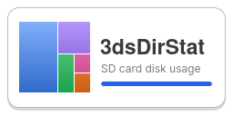

# 3dsDirStat

See what takes up space on your Nintendo 3DS SD card, in the spirit of [WinDirStat](https://windirstat.net/).

<p align="center"></p>

<div align="center">
  <video src="https://github.com/user-attachments/assets/55b982b2-4df7-462e-9b9a-c0775054ce59" width=400/>
</div>

## Features

- **Treemap** on the top screen: each file is a block sized by how much space it uses, colored by file type.
- **Folder list** on the bottom screen, sorted by size, with a usage bar for each item.
- **File types** page showing how much space images, audio, video, 3DS titles and other types take.
- **Delete** files and folders, with a confirmation dialog.
- **System data protection**: nothing inside `Nintendo 3DS/` can be deleted. Remove software, save data and extra data from *System Settings > Data Management* instead.
- Light interface in the style of the 3DS system menus, with touch support and sound effects.

## Controls

| Button | Action |
|---|---|
| D-Pad / Circle Pad | Move the selection |
| L / R or Left / Right | Previous / next page of the list |
| A | Open the selected folder |
| B | Go back to the parent folder |
| X | Delete the selected item (Rescan on the File types page) |
| Y | Switch between the folder list and the File types page |
| START | Exit |
| SELECT | Cancel a scan in progress |

You can also tap an item to select it, tap it again to open it, and drag to scroll.

## Installing

- **CIA**: install `3dsDirStat.cia` with FBI. It then appears on the HOME Menu.
- **3DSX**: copy `3dsDirStat.3dsx` to `sdmc:/3ds/` and start it from the Homebrew Launcher.

Sound effects need the DSP firmware (`sdmc:/3ds/dspfirm.cdc`, created by the DSP1 homebrew). Without it, the app runs silently.

## Building

Requires [devkitPro](https://devkitpro.org) with devkitARM, libctru and citro2d.

```sh
make            # builds 3dsDirStat.3dsx
make cia        # builds 3dsDirStat.cia (also needs bannertool, cxitool and makerom)
```

Increase `VERSION_MAJOR` / `VERSION_MINOR` / `VERSION_MICRO` in the `Makefile` for each release. The HOME Menu only reloads the icon and banner when the version changes.

## Development

- **Host tests** for the platform-independent parts (tree, treemap layout, sizes, colors):

  ```sh
  gcc -std=c11 -Isrc test/test_host.c src/treemap.c src/tree.c src/colors.c src/sizes.c -lm -o test_host && ./test_host
  ```

- **Scripted UI tests**: `make SCRIPT=1` builds a version that replays button presses from `sdmc:/logs/script.txt` and saves screenshots of both screens. See `src/debug.h`.
- **Art and sounds**: `assets/make_art.sh` regenerates the icon and banner. `tools/sfxwav.c` exports the app's synthesized sounds as WAV files.

## AI disclaimer

This is 100% made by AI in basically 1 hour using Claude Opus 5.5 (medium). I have no merit in this, it's as depressing as it gets.
